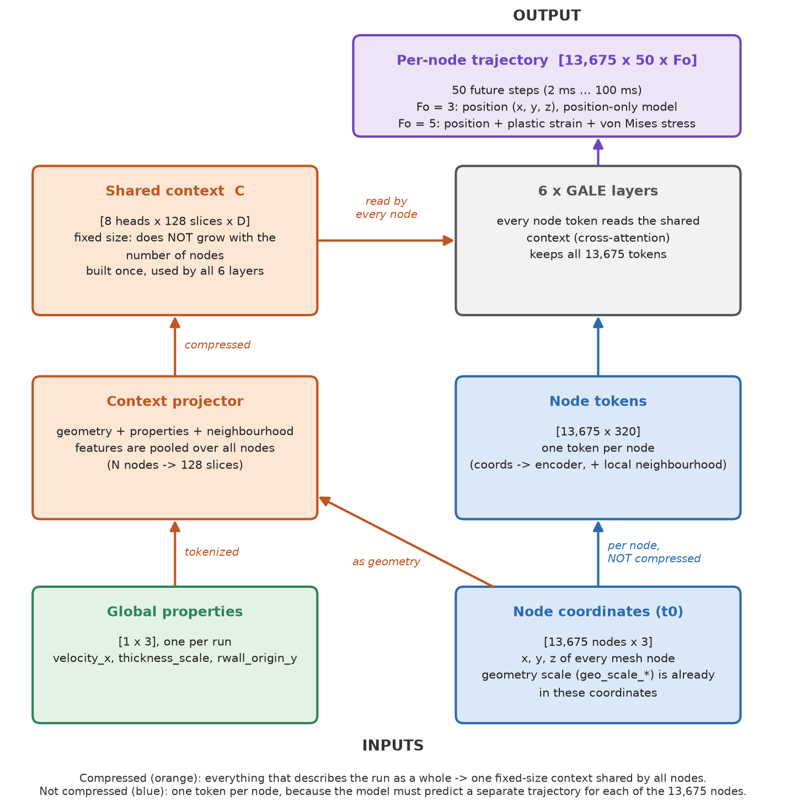
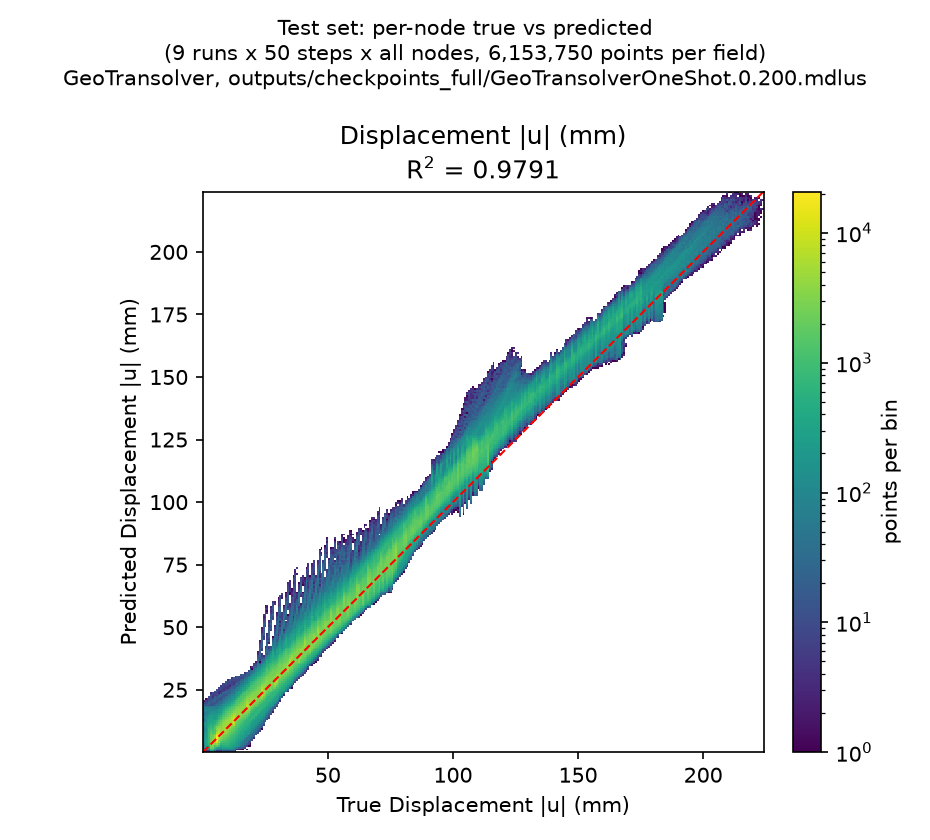
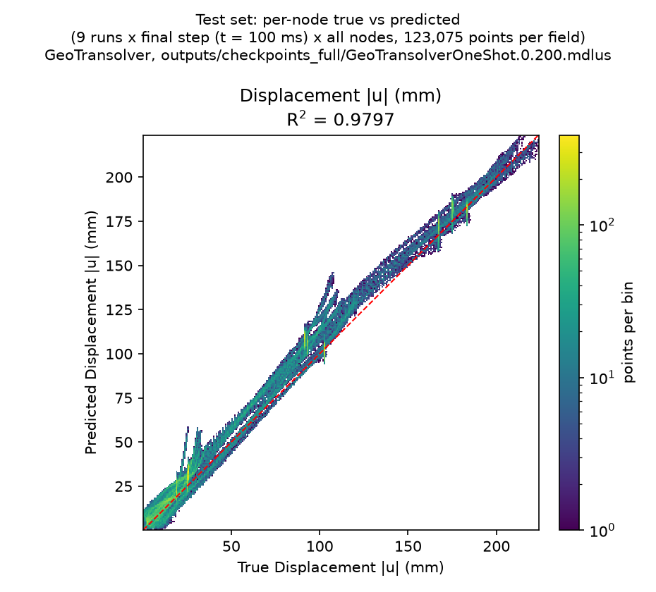
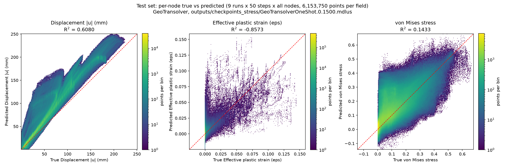
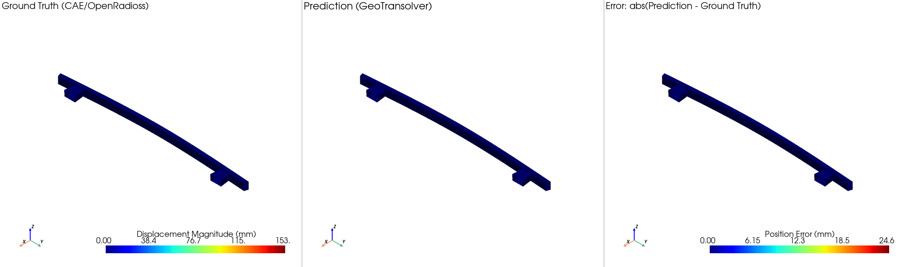
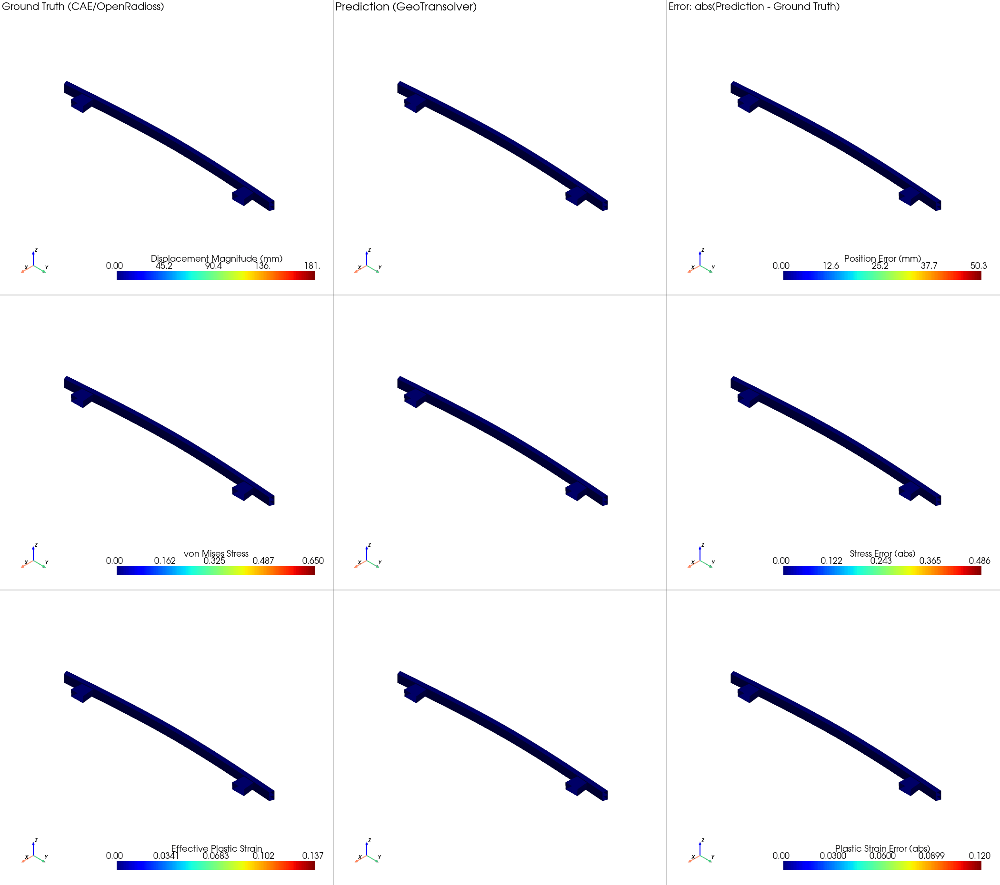
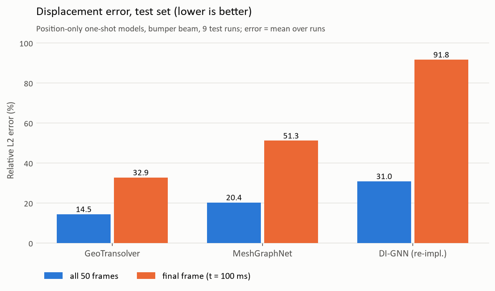
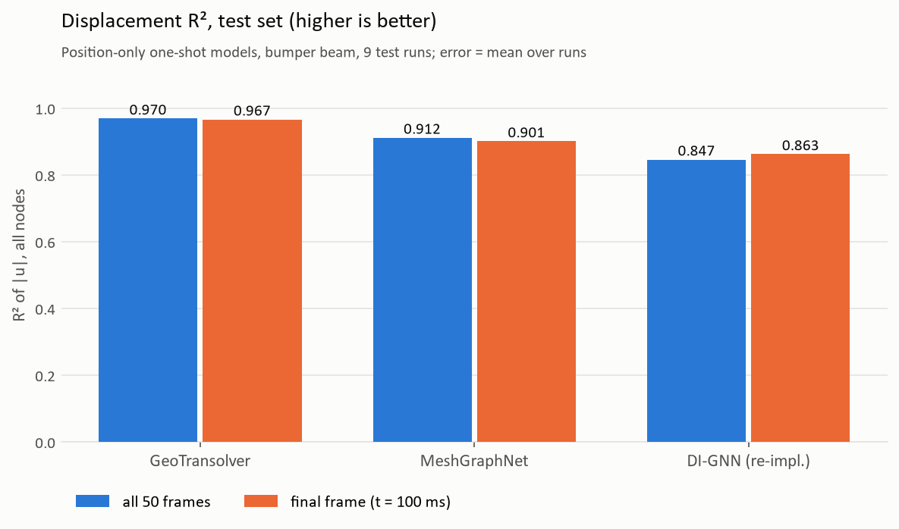
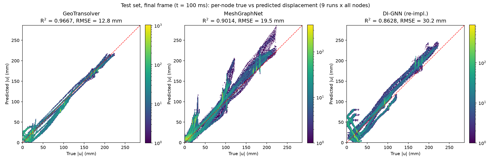

# Bumper Beam 撞擊代理模型：從零重現指南

本文件記錄如何在 **Windows + WSL2** 上，完全從開源工具重現 `examples/structural_mechanics/bumper_beam` 這個 GeoTransolver bumper beam 撞擊代理模型範例——從產生 CAE 模擬資料開始，到訓練出一個能取代 LS-DYNA/OpenRadioss 撞擊模擬的神經網路代理模型。

全程只用開源工具（**OpenRadioss** 取代 LS-DYNA），不需要商用 CAE 授權。

## 整體流程圖

```
DoE 參數表 (generate_dataset.py)
   -> OpenRadioss 求解器 (starter + engine)      -> ANIM/d3plot/T01 (每個 run 一份)
   -> anim_to_vtk + vortex_radioss                -> d3plot (LS-DYNA 相容格式)
   -> PhysicsNeMo-Curator ETL                     -> .vtp (每個 run 一份，含逐時間步位移)
   -> vtp_reader.Reader + CrashPointCloudDataset   -> SimSample (x, y, global_features)
   -> rollout.GeoTransolverOneShot                 -> [N, 50, Fo] 預測軌跡
   -> inference.py + post_processing/              -> 動圖、誤差曲線
```

135 筆模擬（5 種幾何縮放 × 3 種撞擊速度 × 3 種板厚 × 1 種牆直徑 × 3 種牆位置），切成 121 / 5 / 9 筆做 train / val / test，對齊原始 `bumper_geotransolver_oneshot.yaml` 範例的資料量慣例。

---

## 前置需求

| 項目 | 版本/來源 |
|---|---|
| Windows | 10/11，啟用 WSL2 |
| WSL 發行版 | Ubuntu 24.04 |
| OpenRadioss | 從 [OpenRadioss](https://github.com/OpenRadioss/OpenRadioss) 官方 build（GFortran-Linux 版本，`starter_linux64_gf` / `engine_linux64_gf` / `anim_to_vtk_linux64_gf`） |
| PhysicsNeMo | 本地原始碼 checkout（**不要**用 `pip install nvidia-physicsnemo` 裝現成 release，見下方踩坑記錄） |
| PhysicsNeMo-Curator | Git tag **`PNM-25.11-Compatible`**（main branch 已經改版不相容，見下方） |
| Vortex-Radioss | 從 [Vortex-CAE/Vortex-Radioss](https://github.com/Vortex-CAE/Vortex-Radioss) 原始碼安裝（PyPI 上沒有這個套件） |
| GPU | 有 CUDA 的顯卡（本文用 8GB VRAM 驗證過） |

**為什麼要拆兩套 Python 環境？** OpenRadioss 的執行檔只有 Linux ELF 版本，必須在 WSL 裡跑；而 PhysicsNeMo 訓練用 CUDA，在原生 Windows Python（配 CUDA 版 PyTorch）跑最省事。所以：

- **WSL venv**（`/opt/radioss_venv`）：跑 OpenRadioss 批次模擬 + PhysicsNeMo-Curator ETL
- **Windows venv**（PhysicsNeMo repo 根目錄下的 `.venv`）：跑訓練/推論

---

## Part 1 — 環境設置

### 1.1 WSL2 + OpenRadioss

```powershell
wsl --install -d Ubuntu-24.04   # 若尚未安裝
```

在 WSL 裡：

```bash
sudo apt-get update
sudo apt-get install -y python3-venv python3-pip
python3 -m venv /opt/radioss_venv
source /opt/radioss_venv/bin/activate
pip install --upgrade pip
```

把 OpenRadioss 官方 build 放到（例如）`C:\code\2-cae\OpenRadioss`，WSL 裡對應路徑是 `/mnt/c/code/2-cae/OpenRadioss`，確認以下執行檔存在：

```
OpenRadioss/exec/starter_linux64_gf
OpenRadioss/exec/engine_linux64_gf
OpenRadioss/exec/anim_to_vtk_linux64_gf
```

### 1.2 Vortex-Radioss（ANIM → d3plot 轉換工具）

PyPI 上沒有 `vortex-radioss` 這個套件名稱，必須從 GitHub 原始碼裝：

```bash
source /opt/radioss_venv/bin/activate
pip install lasso-python          # 必要前置套件（LS-DYNA d3plot 讀寫）
cd /tmp
git clone https://github.com/Vortex-CAE/Vortex-Radioss.git
cd Vortex-Radioss
pip install -e .
python -c "from vortex_radioss.animtod3plot.Anim_to_D3plot import readAndConvert; print('OK')"
```

### 1.3 PhysicsNeMo-Curator（**指定 tag，不要用 main**）

> **重要踩坑**：curator 的 main branch 已經把 crash ETL 整個重構成 `examples/cae/crashsim/`（argparse CLI、只輸出 Zarr、欄位也不一樣），跟 `physicsnemo` repo 的 crash 範例文件描述的 `physicsnemo-curator-etl --config-name=crash_etl` 介面完全不相容。要用歷史 tag `PNM-25.11-Compatible`：

```bash
cd /opt
git clone https://github.com/NVIDIA/physicsnemo-curator.git
cd physicsnemo-curator
git checkout PNM-25.11-Compatible
source /opt/radioss_venv/bin/activate
pip install --upgrade pip
pip install -e ".[dev]"
```

確認這個 tag 底下有 `examples/structural_mechanics/crash/config/crash_etl.yaml`（main branch 沒有這個路徑）。

### 1.4 PhysicsNeMo（**必須 editable install，不要用 pip release**）

> **重要踩坑**：如果直接 `pip install nvidia-physicsnemo`，裝到的是官方 release（例如 2.2.1），版本比本地原始碼舊，`GeoTransolver` 類別缺少 `activation_checkpointing` 等新參數，訓練會直接報 `TypeError: GeoTransolver.__init__() got an unexpected keyword argument 'activation_checkpointing'`。必須從 PhysicsNeMo repo 根目錄用 **editable install**：

```powershell
cd C:\code\2-cae\physicsnemo          # PhysicsNeMo repo 根目錄
python -m venv .venv
.venv\Scripts\python.exe -m pip install --upgrade pip
.venv\Scripts\python.exe -m pip install -e . --no-deps
.venv\Scripts\python.exe -m pip install torch --index-url https://download.pytorch.org/whl/cu130  # 依你的 CUDA 版本調整
.venv\Scripts\python.exe -m pip install hydra-core omegaconf pyvista tabulate tensorboard torchinfo imageio
```

驗證 editable install 是否生效（在 **bumper beam 範例目錄**下測，不要在 repo 根目錄測，否則 Python 會誤把當前目錄下的 `physicsnemo/` 資料夾當成套件，得到假陽性結果）：

```powershell
cd "C:\code\2-cae\physicsnemo\examples\structural_mechanics\bumper_beam"
..\..\..\.venv\Scripts\python.exe -c "import physicsnemo.models.geotransolver.geotransolver as g; print(g.__file__)"
# 應該印出本地原始碼路徑，不是 .venv\Lib\site-packages\... 底下的複本
```

---

## Part 2 — 產生 CAE 資料集（OpenRadioss DoE）

原始 bumper beam 模型（`Bumper_Beam_AP_meshed`）來自 OpenRadioss 官方範例（[Bumper Beam wiki](https://openradioss.atlassian.net/wiki/spaces/OPENRADIOSS/pages/11075585/Bumper+Beam)），單位系統是 **kg-mm-ms**（所以應力單位是 GPa，速度單位是 mm/ms）。

### 2.1 取得範本並修改 Engine Deck

把官方的 `Bumper_Beam_AP_meshed_0000.rad`（starter，含幾何/材料）跟 `_0001.rad`（engine，控制輸出）放到：

```
physicsnemo/examples/structural_mechanics/bumper_beam/dataset_generation/templates/
```

> **重要踩坑**：官方範例或你手動測試用的 engine deck，如果只寫 `/H3D/DT`（給視覺化用），**不會**產生 `anim_to_vtk` 需要的 ASCII ANIM 檔案（`*A001`, `*A002`, ...），後續整條 pipeline 都會斷掉。必須改成 `/ANIM/DT`：

```
# _0001.rad（engine deck）
/RUN/Bumper_Beam_AP_meshed/0/
                 100
/VERS/2022
/ANIM/DT
#   TSTART     TFREQ
0.000000 2.000000
/ANIM/SHELL/VONM
/ANIM/SHELL/EPSP
/DT/NODA/CST/0
0.9 0.001
/PRINT/-100/55
/TFILE/0
#            dT_HIS
0.100000
```

`TFREQ=2.0`（ms）搭配 100ms 總模擬時間，會產生 **51 個輸出時間點**（t=0,2,4,...,100ms），剛好對應 `num_time_steps: 51`。`/ANIM/SHELL/VONM` 和 `/ANIM/SHELL/EPSP` 額外輸出 von Mises 應力跟塑性應變（後面應力應變擴充會用到）。

### 2.2 產生 DoE 參數組合

```bash
cd "physicsnemo/examples/structural_mechanics/bumper_beam/dataset_generation"
source /opt/radioss_venv/bin/activate
python generate_dataset.py
```

預設的 `DEFAULT_EXPERIMENT_SETUP`（在 `generate_dataset.py` 底部）：

| 參數 | 數值 | 個數 |
|---|---|---|
| 幾何縮放 (sx,sy,sz) | (1,1,1) (1,0.5,1) (1,1,0.5) (1,2,1) (1,1,2) | 5 |
| 撞擊速度 vx (mm/ms) | -5, -3, -7 | 3 |
| 板厚倍率 | 1.0, 0.7, 1.3 | 3 |
| 牆直徑 (mm) | 254 | 1 |
| 牆位置 y (mm) | 0, 120, 240 | 3 |

5×3×3×1×3 = **135 筆**。會產生 `dataset/run1/` ~ `dataset/run135/`，每個資料夾有一份 mutated `_0000.rad` + 複製的 `_0001.rad` + `runN.json`，還有 `dataset/summary.json`（全部參數的紀錄）。

### 2.3 批次執行模擬

```bash
export OPENRADIOSS_ROOT=/mnt/c/code/2-cae/OpenRadioss
export MAX_PARALLEL_JOBS=5      # 見下方「並行度怎麼選」
export OMP_NUM_THREADS=2
python run_simulations.py
```

每個 run 依序跑：`starter` → `engine` → `anim_to_vtk`（轉每個 ANIM frame 成 .vtk） → `vortex_radioss.Anim_to_D3plot`（轉成 d3plot）。

**並行度怎麼選**：不要照直覺開到 CPU 核心數。實測中 6-way 跟 5-way 並行的「整體吞吐量」幾乎一樣（~0.0038 runs/sec），說明系統在 5~6 個並行 run 左右就資源飽和了（很可能是記憶體頻寬或 WSL 檔案系統瓶頸，不是單純的 CPU thread 數問題）——盲目加大並行度不會變快。實務上：先用 1 個 run 測出單筆耗時（本文機器 nt=2 約 450s/run），再用 `MAX_PARALLEL_JOBS = 實體核心數 / OMP_NUM_THREADS` 起手，觀察是否過度訂閱再調整。135 筆全部跑完在本文機器上約需 **8~10 小時**。

**中斷恢復**：這是個跑好幾小時的背景工作，隨時可能被重開機（Windows Update、手動重啟）打斷——WSL2 的 VM 不會在重開機後自動恢復。恢復程序：

```bash
# 1. 把已完整跑完的 run（有 NORMAL TERMINATION + d3plot 轉檔完成）移到備份資料夾
mkdir -p dataset_done
for d in dataset/run*/; do
  name=$(basename "$d")
  if grep -q 'NORMAL TERMINATION' "$d/engine.log" 2>/dev/null && [ -f "$d/Bumper_Beam_AP_meshed.d3plot" ]; then
    mv "$d" "dataset_done/$name"
  fi
done

# 2. 把殘留的部分完成/未開始的 run 重置成乾淨狀態（只留 3 個原始檔）
for d in dataset/run*/; do
  name=$(basename "$d")
  find "$d" -type f ! -name 'Bumper_Beam_AP_meshed_0000.rad' \
              ! -name 'Bumper_Beam_AP_meshed_0001.rad' \
              ! -name "${name}.json" -delete
done

# 3. 重新啟動批次（只會處理 dataset/ 底下還沒跑完的）
python run_simulations.py

# 4. 全部跑完後，把 dataset_done/ 併回 dataset/
for d in dataset_done/run*/; do mv "$d" "dataset/$(basename "$d")"; done
```

> **另一個踩坑**：如果不小心對同一批 run 資料夾啟動了兩次 `run_simulations.py`（例如以為前一次啟動失敗而重跑，但其實它已經在背景成功跑了——Windows/PowerShell 呼叫 `$!` 取得背景 PID 這種語法在某些殼層轉譯情境下會靜默失效），兩個 process 會搶著寫**同一批**最先掃到的 run 資料夾（`ThreadPoolExecutor` 掃描順序是字典序，兩個 process 幾乎同時啟動時會挑到完全相同的前幾筆），造成 log/restart file 互相覆寫、資料損毀。啟動批次後務必 `ps aux | grep run_simulations.py` 確認**只有一個** process。

### 2.4 整理成 Curator 需要的格式

```bash
# 把 <BASE>.d3plot* 重新命名成 d3plot, d3plot01, ...
python common/rename_d3plot.py --dataset-dir ./dataset --base-name Bumper_Beam_AP_meshed  # common/ is copied locally into dataset_generation/

# summary.json -> global_features.json（給訓練用的每個 run 的全域參數）
python restructure_global_features.py --input ./dataset/summary.json --output ./global_features.json
```

`global_features.json` 內容範例：

```json
{
  "run1": {
    "geo_scale_x": 1.0, "geo_scale_y": 1.0, "geo_scale_z": 1.0,
    "velocity_x": -5.0, "velocity_y": 0.0, "velocity_z": 0.0,
    "thickness_scale": 1.0,
    "rwall_diameter": 254.0,
    "rwall_origin_x": -170.0, "rwall_origin_y": 0.0, "rwall_origin_z": 0.0
  }
}
```

**這些 DoE 參數怎麼進到模型**——GeoTransolver 的輸入、輸出，以及哪些會被壓縮成共用的 context、哪些每個節點都要保留：



| | 形狀 | 會不會被壓縮 |
|---|---|---|
| **節點座標（t0）** | `[13675, 3]` | **兩條路都用**：(1) 當成幾何，跟其他資訊一起壓進 context；(2) **每個節點各自一個 token，不壓縮**，一路保留到輸出 |
| **全域參數** | `[1, 3]`：`velocity_x`、`thickness_scale`、`rwall_origin_y` | 壓進 context |
| **Context C** | `[8 heads, 128 slices, D]` | 壓縮後的結果：大小固定，**跟節點數無關**，建一次、6 層共用 |
| **輸出** | `[13675, 50, Fo]` | 每個節點一條軌跡（50 個未來時間步，2~100 ms） |

- **壓縮（橘色）**：描述「這整個 run」的資訊——幾何形狀、撞擊速度、板厚、牆的位置——不管網格有幾個節點，都壓成同一個固定大小的 context，每個節點都去讀它（cross-attention）。
- **不能壓縮（藍色）**：每個節點自己的座標。模型要對 13,675 個節點**各自**預測一條軌跡，所以節點 token 必須一個節點一個，不能合併。
- **幾何縮放（`geo_scale_*`）不是另外餵的參數**：它直接改變了網格座標本身，模型從節點座標就看得到。`global_features.json` 裡其他欄位（`velocity_y/z`、`rwall_diameter`、`rwall_origin_x/z`）在這個 DoE 裡是常數，不需要餵。
- **輸出的 `Fo`**：純位移模型 `Fo = 3`（位置 x, y, z）；加應力應變的模型 `Fo = 5`（位置 + `effective_plastic_strain` + `stress_vm`，見 Part 6）。位置輸出是加在 t0 座標上的殘差。

---

## Part 3 — Curator ETL：d3plot → VTP

```bash
cd /opt/physicsnemo-curator/examples/structural_mechanics/crash
source /opt/radioss_venv/bin/activate
python run_etl.py --config-name=crash_etl \
    serialization_format=vtp \
    etl.source.input_dir=/path/to/bumper_beam/dataset_generation/dataset \
    serialization_format.sink.output_dir=/path/to/bumper_full_vtp \
    serialization_format.sink.time_step=0.002 \
    etl.processing.num_processes=4
```

- `serialization_format.sink.time_step=0.002`：對應我們 ANIM 每 2ms 輸出一次的頻率，讓 VTP 裡的 `displacement_t0.000, displacement_t0.002, ...` 標籤是正確的物理時間（這個參數只是純數字標籤，curator 不會自動讀模擬的真實時間，設錯只會讓標籤跟事實不符，不會報錯，要自己對好）。
- 135 筆全部轉換，本文機器約 **44 秒**。
- `.k` 檔案（LS-DYNA 板厚定義）不存在的警告是正常的——OpenRadioss 用的是 `.rad` 格式，沒有對應的 `.k` 檔，板厚會 fallback 成 0（我們的 config 也沒用到 thickness 這個 static feature，不影響訓練）。

### 3.1 切分 train / val / test

Curator 的 `.vtp` 放在 `data_full/vtk/`（`data_full/compare_vtu/` 留給 ParaView 用的 VTU，見 3.2）：

```bash
mkdir -p data_full/vtk/train data_full/vtk/val data_full/vtk/test
i=0
for f in $(ls /path/to/bumper_full_vtp/*.vtp | sort); do
  i=$((i+1))
  if [ "$i" -le 121 ]; then cp "$f" data_full/vtk/train/
  elif [ "$i" -le 126 ]; then cp "$f" data_full/vtk/val/
  else cp "$f" data_full/vtk/test/
  fi
done
```

`ls | sort` 是字串排序（`run1, run10, run100, ...`），所以 test 是 `run91` ~ `run99`。

### 3.2 匯出 ParaView 用的 VTU（OpenRadioss 真值）

每個 Curator `.vtp` 把整條軌跡塞在同一個檔案裡，ParaView 不好看。`post_processing/export_vtu.py` 把每個 run 拆成每個時間步一個 `.vtu`（網格移到變形後位置），再寫一個 `.pvd` 讓 ParaView 當成時間序列開：

```powershell
..\..\..\.venv\Scripts\python.exe post_processing\export_vtu.py      # 135 筆約 45 秒、4.2 GB；已存在的會跳過
```

```
data_full/compare_vtu/openradioss/<split>/runN/runN.pvd              <- ParaView 開這個
data_full/compare_vtu/openradioss/<split>/runN/vtu/runN_000.vtu ... runN_050.vtu
```

欄位：point data `displacement`（相對 t0 的向量）、`thickness`（全 0，見上方 `.k` 說明）；cell data `stress_vm`、`effective_plastic_strain`（Part 6 注入後才有）。

---

## Part 4 — 訓練

### 4.1 Experiment Config

用範例目錄裡的 `conf/bumper_openradioss_oneshot.yaml`（本文已寫好，複製 `bumper_geotransolver_oneshot.yaml` 改路徑跟 Windows 相容設定）：

```yaml
defaults:
  - reader: vtp
  - datapipe: point_cloud
  - model: geotransolver_one_shot
  - training: default
  - inference: default
  - _self_

training:
  raw_data_dir: ???
  raw_data_dir_validation: ???
  global_features_filepath: ???
  optimizer: muon
  num_time_steps: 51
  num_training_samples: ???
  num_validation_samples: ???
  num_dataloader_workers: 0   # Windows 必須是 0，見下方踩坑

datapipe:
  static_features: []
  dynamic_targets: []          # 見下方「應力應變擴充」章節，預設先只練位移
  global_features:
    - velocity_x
    - thickness_scale
    - rwall_origin_y

model:
  functional_dim: 3
  out_dim: 150                 # (num_time_steps-1) * Fo，Fo=3（只有位移）
  global_dim: 3
```

### 4.2 啟動訓練

```powershell
cd "C:\code\2-cae\physicsnemo\examples\structural_mechanics\bumper_beam"
..\..\..\.venv\Scripts\python.exe train.py --config-name=bumper_openradioss_oneshot `
  training.raw_data_dir=<abs path>/data_full/vtk/train `
  training.raw_data_dir_validation=<abs path>/data_full/vtk/val `
  training.global_features_filepath=<abs path>/global_features.json `
  training.num_training_samples=121 `
  training.num_validation_samples=5 `
  training.epochs=1500 `
  training.validation_freq=25 `
  training.save_checkpoint_freq=100 `
  inference.raw_data_dir_test=<abs path>/data_full/vtk/test
```

> **踩坑 1 — 一定要用絕對路徑**：config 裡 `hydra: job: chdir: True` 會讓程式在執行前先切到 `./outputs/`，所以任何相對路徑（`./data_full/vtk/train` 之類）都會相對於**新的** cwd 解析失敗，报 "No .vtp files found"。所有 `raw_data_dir` 系列參數要傳絕對路徑。

> **踩坑 2 — Windows 上 `num_dataloader_workers` 必須是 0**：這個 dataset 內部用了一個 closure/lambda 建構 `SimSample`，Windows 的 `multiprocessing` 用 `spawn` 開子行程時需要把整個 dataset 物件 pickle 傳給子行程，lambda 不可 pickle，會報 `AttributeError: Can't get local object '...<lambda>'`。設 `num_dataloader_workers=0`（用主行程載入資料）就完全繞開，代價是資料載入變成單執行緒，但這個資料集不大，影響很小。Linux 上沒有這個限制，可以開大一點加速。

> **踩坑 3 — PowerShell 多行指令的反引號續行符**：PowerShell 用單個反引號 `` ` `` 續行，且必須是該行**最後一個字元**（後面不能有空白）。用連續 4 個反引號、或反引號後面接空格，會整個爆炸成一堆 `CommandNotFoundException`（因為 PowerShell 把後續每一行都當成獨立指令執行）。保險做法：直接把整條指令寫成**一行**，或用 `EnterPlanMode`/heredoc 之類的機制，別手動湊多行續行符。

訓練速度參考（GeoTransolver, 121 訓練樣本, batch_size=1，RTX 顯卡 8GB VRAM）：約 **20 秒/epoch**（GPU 使用率 ~70%，沒有跑滿是因為 batch_size=1 造成的 Python/資料載入開銷，這是 pipeline 現有限制，README 的 TODO 裡也提到「支援 batch_size>1」）。

### 4.3 TensorBoard 監控

```powershell
..\..\..\.venv\Scripts\python.exe -m tensorboard.main --logdir outputs\tensorboard_logs --port 6006
```

開 http://localhost:6006/ 看 loss / 驗證 MSE 曲線。

每次驗證（`training.validation_freq`）時，`train.py` 也會把**第一個驗證 run 最後一個時間步**畫成 Ground Truth / Prediction / Error 三欄對比圖（列：位移、以及 config 裡的每個 dynamic target），寫進 TensorBoard 的 **Images** 分頁（tag `val/true_pred_error_<run>`），不用等訓練完就能直接看模型畫出來的樣子。用的是跟 5.2 動圖同一個 PyVista renderer。設 `training.log_val_image=False` 可以關掉；渲染失敗只會記 warning，不會中斷訓練。

### 4.4 (已移除) 訓練中即時產生對比動圖

原本這裡有一支 `post_processing/live_gif_watcher.py`，會另外輪詢 checkpoint 目錄、呼叫一次 `inference.py` 對單一 test run 產生 True/Predict 動圖。後來發現這個功能**完全是多餘的**——4.3 提到的 TensorBoard Images 分頁，`train.py` 每次驗證就會自動畫好 Ground Truth / Prediction / Error 三欄對比圖，不用另外啟動一個會跟 `train.py` 搶 `outputs/launch.log` 寫入權限（見原本這裡記錄的 `PermissionError` 踩坑）的監控程序。已經把這支腳本刪掉，單純用 TensorBoard 就夠。

### 4.5 何時該停止訓練

這個資料量級（121 筆）+ 這個模型大小，實測驗證 MSE 大約在幾百個 epoch 內就會收斂到平原期（本文案例：純位移訓練約 200 epoch 收斂到 MSE~0.002；加了應力應變後約 600~900 epoch 進入平原）。可以邊看 TensorBoard／即時動圖邊決定要不要提前停止，不用死等 `training.epochs` 設定的值跑完——把訓練跑到 5000 epoch 的完整長度往往是浪費時間，尤其是這個資料量級。

---

## Part 5 — 推論與視覺化

### 5.1 跑推論

```powershell
..\..\..\.venv\Scripts\python.exe inference.py --config-name=bumper_openradioss_oneshot `
  training.raw_data_dir=<...>/data_full/vtk/train `
  training.raw_data_dir_validation=<...>/data_full/vtk/val `
  training.global_features_filepath=<...>/global_features.json `
  training.num_training_samples=121 `
  training.num_validation_samples=5 `
  training.num_dataloader_workers=0 `
  training.ckpt_path=./checkpoints `
  inference.raw_data_dir_test=<...>/data_full/vtk/test
```

輸出在 `outputs/predicted_vtps/rank0/<run_name>/frame_XXX_pred.vtp` 跟 `outputs/exact_vtps/rank0/<run_name>/frame_XXX_exact.vtp`。

> **踩坑 — Windows 沒有 symlink 權限**：`inference.py` 原本用 `os.symlink()` 把單一 run 的 VTP 連到暫存資料夾，Windows 預設沒有開發者模式/系統管理員權限時會報 `OSError: [WinError 1314] 用戶端沒有這項特殊權限`。已在本文的 `inference.py` 加上 fallback：symlink 失敗就改用 `shutil.copy2()`。

### 5.2 True / Predicted / Error 動圖

`post_processing/make_true_pred_error_gif.py` 用 PyVista 直接渲染（比 matplotlib `plot_trisurf` 乾淨很多），jet 色階、固定等角視角。每一列一個物理量（位移、von Mises 應力、塑性應變），三欄依序是 **Ground Truth | Prediction | Error**：最右邊的誤差欄畫在真值的變形形狀上，位移是位置誤差 `|x_pred - x_true|`（mm），應力應變是 `abs(pred - true)`，色階範圍各自獨立（0 到所有時間步的最大誤差）：

```powershell
..\..\..\.venv\Scripts\python.exe post_processing\make_true_pred_error_gif.py `
  --exact_dir outputs\exact_vtps\rank0\run91 `
  --pred_dir outputs\predicted_vtps\rank0\run91 `
  --reference_vtp data_full\vtk\test\run91.vtp `
  --output_gif outputs\run91_true_pred.gif
```

兩種模型的動圖跟比較見 [Part 7.3](#73-true--pred--error-動圖test-run91)。

相機角度預設 `iso`（等角，配合 `reset_camera()` 自動框住整個 bumper beam）。用 `--camera xy|xz|yz` 可以切換成正交軸向視角，但要注意這個模型的長軸是 Y，`yz` 視角會看到側視的長條，`xz` 視角會看到一個很小的端面——不是所有角度都能看清楚變形，`iso` 通常最好懂。

`post_processing/per_field_mse.py` 可以從 exact VTP 裡的 `difference` / `diff_<field>` 欄位算出位移跟各個 dynamic target 各自的 MSE，比訓練 log 裡合併起來的單一 MSE 更能看出每個物理量各自的收斂狀況。

### 5.3 匯出 GeoTransolver 預測的 VTU

`post_processing/export_pred_vtu.py` 用訓練好的 checkpoint 對**全部** 135 筆（train/val/test）跑推論，輸出跟 3.2 真值完全同樣結構、同樣時間步編號的 VTU，可以在 ParaView 把同一個 run 的真值跟預測並排開：

```powershell
# 應力模型（預設 checkpoints_stress epoch 1500）-> compare_vtu/predict/ + metrics.csv
..\..\..\.venv\Scripts\python.exe post_processing\export_pred_vtu.py

# 純位移模型（checkpoints_full epoch 200）-> compare_vtu/predict_disponly/ + metrics_disponly.csv
..\..\..\.venv\Scripts\python.exe post_processing\export_pred_vtu.py `
  --ckpt outputs\checkpoints_full\GeoTransolverOneShot.0.200.mdlus `
  --out_dir data_full\compare_vtu\predict_disponly `
  --metrics data_full\compare_vtu\metrics_disponly.csv
```

```
data_full/compare_vtu/predict/<split>/runN/runN.pvd
data_full/compare_vtu/predict/<split>/runN/vtu/runN_000.vtu ... runN_050.vtu
data_full/compare_vtu/metrics.csv        # 每個 run 的 disp / ux / uy / uz / effective_plastic_strain / stress_vm 誤差 (%)，最後幾列是 train/val/test/all 平均
data_full/compare_vtu/predict/checkpoint.txt     # 用哪個 checkpoint 產生的
data_full/compare_vtu/predict_disponly/...       # 純位移模型，同樣結構（沒有應力應變欄位）
data_full/compare_vtu/metrics_disponly.csv       # 純位移模型的 disp / ux / uy / uz 誤差 (%)
data_full/compare_vtu/r2_scatter_per_node.png            # test 逐節點 true vs pred + R²（應力模型）
data_full/compare_vtu/r2_scatter_per_node_disponly.png   # 同上（純位移模型，只有位移）
data_full/compare_vtu/r2_scatter_per_node*_last.png      # 同上，只用最後一個時間步（--last_frame）
```

`r2_scatter_*.png` 由 `post_processing/plot_r2_scatter.py` 產生（`--predict_dir` 指定預測資料夾、`--fields` 選欄位），R² 用 test 全部節點、全部 50 個預測時間步計算（`--last_frame` 只用最後一個時間步），位移是相對 t0——**不要對絕對座標算 R²**：beam 長 2 m，連「完全不變形」的預測對絕對座標都會有 R² ≈ 0.9999。

- frame 000 是未變形的輸入幾何，模型預測的是 frame 001~050。
- `metrics.csv` 的誤差是**相對 L2 誤差（%）**：`100 × ‖pred − true‖₂ / ‖true‖₂`，對一個 run 的全部節點、全部 50 個預測時間步一起算；`disp` 是相對 t0 的位移向量（三個分量一起算），`ux/uy/uz` 是它的分量；`effective_plastic_strain`（OpenRadioss `/ANIM/SHELL/EPSP`）跟 `stress_vm`（von Mises 應力，`/ANIM/SHELL/VONM`）沿用 dataset `dynamic_targets` 跟 VTU 欄位的名稱。`run = mean` 的列是各 split（train / val / test）跟全部 run 的平均。撞擊方向是 x，`uy`、`uz` 的真值很小，所以同樣幾 mm 的誤差在百分比上會很大。
- point data：`displacement`、`error_displacement`（`|pred - true|`，mm），應力模型另外有 `stress_vm`、`effective_plastic_strain`、`error_stress_vm`、`error_effective_plastic_strain`（pred - true）。
- 模型是純位移還是含應力應變，直接從 `.mdlus` 裡的 `args.json` 讀 `out_dim` 判斷，不用另外指定 config。輸出跟 `inference.py` 逐點完全一致。
- 推論時 dataset 用 `split="validation"` 載入 `outputs/stats/` 的訓練統計量——用 `split="train"` 會重新計算並**覆寫**訓練用的正規化統計量。

---

## Part 6 — (進階) 讓模型同時預測應力與塑性應變：資料流程已完成，預測精度未解決

### 6.1 資料從哪來

Curator（`PNM-25.11-Compatible`）的 `CrashD3PlotDataSource` 只從 d3plot 讀節點座標/位移/厚度/連接關係，**不會**讀應力應變——即使我們的 engine deck 有輸出 `/ANIM/SHELL/VONM` 跟 `/ANIM/SHELL/EPSP`，這兩個欄位在 `vortex_radioss` 的 ANIM→d3plot 轉換過程中被丟掉了（變成全零的 `element_shell_unknown_variables`）。

好消息：**這兩個欄位其實好好地存在於 `anim_to_vtk` 產生的 `.vtk` 檔案裡**（`run_simulations.py` 本來就會產生這些檔案，只是沒接進訓練資料），欄位名稱是 `2DELEM_Von_Mises`（CELL_DATA）跟 `2DELEM_Plastic_Strain`（CELL_DATA）。

### 6.2 怎麼接進去

`vtp_reader.py` 其實已經內建支援讀取 cell-data 命名為 `cell_stress_vm_t{time}` / `cell_effective_plastic_strain_t{time}` 的欄位（會自動用 `cell_data_to_point_data()` 轉成 node data，再拿掉 `cell_` 前綴），所以整個接法就是：把 `.vtk` 裡的 `2DELEM_Von_Mises`/`2DELEM_Plastic_Strain`，用 `ELEMENT_ID` 對應到 curator 輸出的 VTP 網格，寫回去當新的 cell-data 欄位即可，**完全不用改 reader 或 datapipe 程式碼**。

對應方式（`.vtk` 的 cell 順序跟 d3plot 的 element 順序不一樣，且 `.vtk` 裡混了殼元素跟樑元素）：

1. 用 `lasso.dyna.D3plot` 讀出 `element_shell_ids`（權威的殼元素順序）。
2. 用 pyvista 讀 `.vtk`，篩選出 `celltype in [TRIANGLE, QUAD]` 且 `ELEMENT_ID` 落在 shell id 集合裡的 cell——這個過濾條件剛好給出一個**乾淨的一對一對應**（本案例驗證：13626 個 shell id，過濾後恰好 13626 個 cell，無重複無缺漏；樑元素跟少數參考幾何體的 id 剛好被篩掉）。
3. 依 `element_shell_ids` 的順序重新排列應力應變值，寫成新的 cell-data 陣列存回 curator 產生的 VTP。

```python
# post_processing/... 的核心邏輯（完整版見 dataset_generation/templates/_inject_stress_strain.py）
is_2d = np.isin(ctypes, [VTK_TRIANGLE, VTK_QUAD])
cand = np.where(is_2d & np.isin(elem_id, shell_id_set))[0]
id_to_cell = {elem_id[ci]: ci for ci in cand}   # 先到先得，因為驗證過沒有重複
ordered_idx = [id_to_cell[sid] for sid in shell_ids]
vtp.cell_data[f"cell_stress_vm_t{t:.3f}"] = vonm[ordered_idx]
vtp.cell_data[f"cell_effective_plastic_strain_t{t:.3f}"] = eps[ordered_idx]
```

> **在動手寫這段對應邏輯之前，務必先驗證每一筆 run 的殼元素數量在 d3plot 跟 curator VTP 之間是否一致**（本案例 135 筆全部一致，零例外）——如果 Curator 的 `WallNodeFilter` 真的濾掉了某些殼元素（不同幾何/參數組合下並非不可能），上面「依原始順序重排」的假設就不成立，需要改用逐節點/逐元素的 remap 邏輯。

跑一次可以在 4~5 秒內處理完一個 run（51 個 timestep 全部處理），135 筆全部跑完約 **10 分鐘**。

### 6.3 改 Config 加入這兩個目標

```yaml
datapipe:
  dynamic_targets:
    - effective_plastic_strain
    - stress_vm

model:
  out_dim: 250   # (51-1) * 5 = 50 * (3 位移 + 1 應變 + 1 應力)，剛好對回原始 bumper_geotransolver_oneshot.yaml 的預設值
```

### 6.4 已知問題：位移精度會被拖累，訓練越久越明顯

實測（同一份 121 筆訓練資料，模型/超參數都不變，只是多加了應力應變目標）：

| Epoch | 位移 MSE (mm², 原始尺度) | 應力 MSE | 塑性應變 MSE |
|---|---|---|---|
| 100 | 70.8 | 0.00910 | 0.000109 |
| 500 | 50.8 | 0.01061 | 0.000039 |
| 900 | 99.4 | 0.01065 | 0.000024 |
| 1100 | **252.6** | 0.01047 | 0.000029 |
| 1500 | 137.8 | 0.00991 | 0.000026 |

- **塑性應變**：平滑收斂，700 epoch 後穩定在很低的誤差。
- **應力**：從頭到尾在 0.0095~0.0114 之間震盪，沒有真正收斂，但也沒惡化——單純卡住。
- **位移**：**沒有穩定，訓練越久反而越糟且雜訊越大**（跟同資料量、只練位移那次訓練的平滑收斂完全不同）。

原因推測：`train.py` 用單一個 `torch.nn.MSELoss()` 直接加總所有 5 個 channel 的誤差（位移是原始 mm 尺度、應力應變是 0~1 量級的小尺度），沒有做 per-channel 正規化或權重平衡，導致三個物理量的梯度互相干擾，訓練越久反而讓本來學得很好的位移被拖垮。**這不是訓練時間不夠**——本文驗證過拉長訓練到 1500+ epoch 並不會自己解決，需要動手改 loss（例如各 channel 各自算 MSE 再加權平均、或依各 channel 的資料標準差做正規化）才能修好。這是留給後續改進的方向，本文先誠實記錄現況。

若只需要準確的位移代理模型、不需要應力應變，維持 `dynamic_targets: []`（Part 4 的預設設定）是目前唯一驗證過完全收斂的路徑。

---

## Part 7 — 結果比較：純位移模型 vs 位移 + 應力應變模型

同一份 121 筆訓練資料、同一個 GeoTransolver 架構，只差在要不要多預測應力跟塑性應變。兩個模型都用 `post_processing/export_pred_vtu.py` 對全部 135 筆跑推論，誤差全部在 test 的 9 筆（`run91`~`run99`）上算，對所有節點、所有 50 個預測時間步一起計算。下面的圖都在 [`figures/`](figures/)。

| | 純位移模型 | 位移 + 應力應變模型 |
|---|---|---|
| checkpoint | `outputs/checkpoints_full/GeoTransolverOneShot.0.200.mdlus` | `outputs/checkpoints_stress/GeoTransolverOneShot.0.1500.mdlus` |
| `dynamic_targets` / `out_dim` | `[]` / 150 (50 × 3) | `[effective_plastic_strain, stress_vm]` / 250 (50 × 5) |
| 訓練 epoch | 200 | 1500 |
| 預測 VTU | `data_full/compare_vtu/predict_disponly/` | `data_full/compare_vtu/predict/` |
| 誤差表 | `data_full/compare_vtu/metrics_disponly.csv` | `data_full/compare_vtu/metrics.csv` |

### 7.1 誤差（相對 L2 %，越小越好）

`error_% = 100 × ‖pred − true‖₂ / ‖true‖₂`；`disp` 是相對 t0 的位移向量。

| split | 純位移：disp | 應力模型：disp | 應力模型：eps | 應力模型：von Mises |
|---|---|---|---|---|
| train | 12.70 | **3.74** | 35.79 | 16.44 |
| val | 8.02 | 8.52 | 66.46 | 30.52 |
| **test** | **13.60** | 42.91 | 135.07 | 59.25 |

應力模型在 train 上的位移誤差只有 3.7%，到 test 卻變成 42.9%——**過擬合**，擬合訓練資料很好但泛化很差。純位移模型 train / test 差不多（12.7% / 13.6%），泛化穩定，在 test 上好三倍。

### 7.2 R² 散佈圖（test，逐節點 true vs pred）

用 `post_processing/plot_r2_scatter.py` 畫，9 筆 test × 50 個時間步 × 全部 13,675 個節點 = 每個欄位 6,153,750 個點全部納入 R²（`1 − SS_res / SS_tot`），用 2D 直方圖（log 色階）呈現。

| | R²（test，50 個時間步） | R²（test，只有最後狀態 t = 100 ms） |
|---|---|---|
| 純位移模型：位移 \|u\| | **0.979** | **0.980** |
| 應力模型：位移 \|u\| | 0.608 | 0.641 |
| 應力模型：塑性應變 eps | −0.857 | −1.348 |
| 應力模型：von Mises 應力 | 0.143 | −0.121 |

「只有最後狀態」是 `plot_r2_scatter.py --last_frame`：只用第 050 個時間步（9 筆 × 13,675 節點 = 123,075 點），對應只預測最終狀態的代理模型的評估方式（見 Part 8）。純位移模型兩種算法幾乎一樣，表示 R² 不是靠早期小變形撐起來的；最後狀態的位移 RMSE 10.41 mm（向量）、相對 L2 11.4%。

**純位移模型**——點幾乎都貼著對角線：



只看最後狀態：



**位移 + 應力應變模型**——位移幾乎全部落在對角線上方（系統性高估，變形越大越明顯）；塑性應變大部分真值是 0，預測卻在 0 附近上下散開；von Mises 應力散得很開，甚至有物理上不可能的負值：



> **不要對絕對座標算 R²。** beam 長 2 m（y 從 −1012 到 +1012 mm），變異幾乎全部來自幾何本身，連「完全不變形」的預測對絕對座標都會有 R² ≈ 0.9999。同一份 test 資料，應力模型對絕對座標的 R² 是 0.9995，對位移卻只有 0.608。R² 跟相對 L2 在同一份資料上可以互相換算：`R² = 1 − relL2² × Σy² / Σ(y − ȳ)²`，兩個指標不會一個好一個壞。

### 7.3 True / Pred / Error 動圖（test `run91`）

用 `post_processing/make_true_pred_error_gif.py` 畫，三欄依序是 **Ground Truth | Prediction | Error = abs(Prediction − Ground Truth)**。誤差欄畫在真值的變形形狀上，色階獨立（0 到所有時間步的最大誤差），看得出模型錯在哪裡、不只是錯多少。

**純位移模型**（最後一步最大位置誤差約 25 mm）：



**位移 + 應力應變模型**（列：位移、von Mises 應力、塑性應變；最後一步最大位置誤差約 50 mm）：



9 筆 test 的應力模型動圖都在 `outputs/test_gifs/runN_true_pred.gif`。重畫純位移模型的動圖：

```powershell
..\..\..\.venv\Scripts\python.exe post_processing\make_true_pred_error_gif.py `
  --exact_dir outputs\exact_vtps_full\rank0\run91 `
  --pred_dir outputs\predicted_vtps_full\rank0\run91 `
  --reference_vtp data_full\vtk\test\run91.vtp `
  --output_gif figures\run91_disponly_true_pred_error.gif `
  --fields displacement
```

### 7.4 結論

- **要位移代理模型，用純位移模型**（`dynamic_targets: []`）：test 位移 R² 0.979、相對 L2 13.6%。
- **多加應力應變目標會拖垮位移**（test R² 0.979 → 0.608），而應力應變本身在 test 上也幾乎沒有預測力（R² 0.14 / −0.86）。原因見 6.4：單一 `MSELoss` 直接加總不同尺度的 channel。
- `uy`、`uz` 跟塑性應變的百分比誤差特別大，主要是真值本身很小（撞擊方向是 x、塑性應變只在局部非零），看這幾個量時用絕對誤差（mm）或除以最大值比較有意義。

---

## Part 8 — 相關研究：同樣是 bumper，但不是同一個 case

R. Gulakala, M. Stoffel, *Global Graph Surrogates and Neural Graph Elements for Computational Mechanics*, PAMM 26(4), e70233, 2026（開放取用，[doi:10.1002/pamm.70233](https://doi.org/10.1002/pamm.70233)）。這篇也用圖神經網路做鋁製汽車 bumper 撞擊的代理模型（DI-GNN），但模型、資料、評估方式都跟本文不同，**數字不能直接比較**。

### 8.1 Case 比較

| | 論文 | 本文 |
|---|---|---|
| 模型來源 | 自建 Abaqus 模型（有 crash box） | OpenRadioss 官方範例 `Bumper_Beam_AP_meshed` |
| 求解器 | Abaqus/Explicit | OpenRadioss |
| 材料 | 鋁，Johnson–Cook（A = 520 MPa、B = 477 MPa、E = 70 GPa） | 範例原本的彈塑性殼材料 |
| 負載 | 一端全固定、另一端給定速度的軸向撞擊 | 圓柱剛性牆撞擊 |
| DoE | 截面形狀 A~E × 長度 1100/1200/1300 mm × 深度 150/200/250 mm × 板厚 1.0~3.0 mm，全因子 **225 筆**；**截面拓樸會變** | 幾何縮放 × 撞擊速度 × 板厚縮放 × 牆 y 位置，**135 筆**；截面拓樸不變，**負載會變** |
| 切分 | 180 / 45（只有 train / validation，論文的 "test set of 45" 就是這 20%） | 121 / 5 / 9（train / val / test） |
| 預測 | **只有最終狀態**的位移、應力、應變場 | **整段時間歷程**（50 個時間步）；位移，或位移 + 塑性應變 + von Mises |
| 模型 | DI-GNN：1 層 FEMAT + 7 層 GATv2，8 heads，hidden 128，約 1.2M 參數，500 epoch | GeoTransolver one-shot |
| Loss | MSE + 位移梯度損失 + 線彈性本構殘差，兩階段（data loss 收斂後才打開物理項） | 純 MSE |

### 8.2 結果

論文（45 筆，最終狀態的位移）：

| 模型 | RMSE (mm) | R² |
|---|---|---|
| DI-GNN | 12.75 | 0.846 |
| EA-GNN | 14.05 | 0.785 |
| MeshGraphNet | 15.25 | 0.702 |

本文的純位移 GeoTransolver（test 9 筆、全部節點）：

| 評估範圍 | RMSE (mm) | R² | 相對 L2 |
|---|---|---|---|
| 50 個時間步 | — | 0.979 | 13.6% |
| **只有最後狀態**（跟論文同一個口徑） | **10.41** | **0.980** | 11.4% |

（RMSE 是位移向量誤差的均方根；最後狀態 test 的平均位移 69.6 mm，各筆最大位移 30~224 mm。）

同樣只看最終狀態，本文的數字還是比較好，但**不代表模型比較好**：

1. 論文的 DoE 換截面拓樸（5 種截面），比本文的幾何縮放難外插。
2. 兩邊的變形量級不同（論文沒給位移範圍），RMSE 的 mm 不能直接比；R² 比較不受量級影響，但也跟資料本身的變異有關。
3. 論文沒有獨立的 test set，45 筆就是驗證集；本文 test 只有 9 筆。

### 8.3 讀論文時注意

- 式 (3) 的節點輸入包含「應力狀態 σᵢ」，論文沒說清楚是初始應力還是模擬結果；如果是後者就等於把答案放進輸入。
- 本構損失用線彈性的 C，但材料是 Johnson–Cook 塑性；作者自己說這只是輔助引導，不是物理一致的約束。
- 圖 5~7 的說明寫長度 1500 mm，跟表 1 的 1100~1300 mm 對不起來。

### 8.4 可以借鏡的地方

- **幾何感知正規化（LMGS）**：位置、位移除以 L_ref（網格最大尺寸），應力除以 E，讓不同尺寸的幾何落在同一個尺度。本文 DoE 有幾何縮放，可以試；deforming plate 的「行程尺度化」（`deforming_plate_surrogate` 實驗 G4）是同一類想法。
- **兩階段 loss**：先只用 data loss 訓練到收斂，再加其他項。可以用在 6.4 的問題：加了應力、應變目標後位移 R² 從 0.979 掉到 0.608，可以先訓練位移、之後再打開應力應變項（或分別給權重）。

8.4 的 LMGS 正規化跟兩階段 loss 在 Part 9 的 DI-GNN 重現裡實際試過：在這份資料的 test 上沒有幫助。

---

## Part 9 — 三種模型比較：GeoTransolver vs MeshGraphNet vs DI-GNN（重現）

同一份資料、同一個任務，比較三種模型：

- **GeoTransolver**：本文原本的模型（transformer，有全域 context）。
- **MeshGraphNet**：PhysicsNeMo 內建、論文也拿來當 baseline 的圖神經網路。
- **DI-GNN**：依 Part 8 論文第 3 節自己重寫的版本。

### 9.1 共同設定

- 資料：135 筆，121 / 5 / 9（train / val / test），跟 Part 4 相同。
- 任務：**只預測位移**（`dynamic_targets: []`），one-shot 一次輸出 50 個時間步。
- 訓練：500 epoch，cosine 學習率排程跑完整個週期，評估用最後一個 epoch。Part 7 的純位移 GeoTransolver 雖然訓練了 200 epoch，但排程是照 5000 epoch 設的，學習率幾乎沒降，所以這裡重新訓練一次（舊的保留在 `outputs/checkpoints_full/`）。

| | GeoTransolver | MeshGraphNet | DI-GNN（重現） |
|---|---|---|---|
| Config | `bumper_openradioss_oneshot` + `datapipe.dynamic_targets=[] model.out_dim=150` | `bumper_mgn_oneshot` | `bumper_dignn_oneshot` |
| 類別（`rollout.py`） | `GeoTransolverOneShot` | `MeshGraphNetOneShot` | `DIGNNOneShot`（新增） |
| 資料表示 | 點雲 | 圖（網格邊） | 圖（網格邊） |
| 參數 | 7.16M | 2.35M | 0.32M |
| Optimizer / lr | Muon / 1e-4 | Muon / 1e-4 | Adam / 1e-3 → 1e-5（照論文） |
| 每個 epoch（RTX 4060 Ti） | 20 s | 23 s | 7 s |
| 訓練資料夾 | `outputs_geotransolver/` | `outputs_mgn/` | `outputs_dignn/` |

指令（在本資料夾下執行）：

```powershell
$PY = "..\..\..\.venv\Scripts\python.exe"
& $PY train.py --config-name=bumper_dignn_oneshot
& $PY train.py --config-name=bumper_mgn_oneshot
& $PY train.py --config-name=bumper_openradioss_oneshot hydra.run.dir=./outputs_geotransolver `
  'training.raw_data_dir=${hydra:runtime.cwd}/data_full/vtk/train' 'training.raw_data_dir_validation=${hydra:runtime.cwd}/data_full/vtk/val' `
  'training.global_features_filepath=${hydra:runtime.cwd}/dataset_generation/global_features.json' `
  'inference.raw_data_dir_test=${hydra:runtime.cwd}/data_full/vtk/test' training.num_training_samples=121 training.num_validation_samples=5 `
  training.epochs=500 training.validation_freq=25 training.save_checkpoint_freq=50 'datapipe.dynamic_targets=[]' model.out_dim=150
# 評估 + 匯出 VTU（predict_<tag>/、metrics_<tag>.csv、summary_<tag>.json）
& $PY post_processing\export_pred_vtu.py --run_dir outputs_dignn --tag dignn      # 另外兩個：outputs_mgn / outputs_geotransolver
& $PY post_processing\plot_model_comparison.py
```

> **8 GB 顯卡一次只跑一個訓練。** 三個同時跑會把顯存吃滿，Windows 開始把顯存換到系統記憶體，每個 epoch 從 20 秒變成 100 秒以上。

### 9.2 DI-GNN 怎麼重現

`rollout.DIGNNOneShot` 照論文第 3 節實作，用 PyG 的 `GATv2Conv`。論文沒寫清楚、或跟這份資料對不上的地方，處理方式如下：

| 論文 | 本文實作 |
|---|---|
| 節點特徵 h = [x, u_bc, σ, m] | x 經 LMGS 正規化；u_bc = 撞擊速度、牆的 y 位置；m = 板厚縮放。σ（初始應力）在這份資料是 0，不放 |
| FEMAT（式 5–6）：GATv2 + W_x·Δx + W_m·Δm + W_d·(d_i⊙d_j) | 第 1 層 `GATv2Conv(edge_dim=8)`，邊特徵是 [標準化的 dx, dy, dz, \|d\|, Δm, d_i⊙d_j]。對串接起來的邊特徵做一個線性映射，跟三個 W 分開相加是等價的。d_i 用鄰居位置做 PCA 估殼的法向量，取絕對值，因為法向量的正負號是任意的 |
| 1 FEMAT + 7 GATv2、8 heads、hidden 128、LeakyReLU 0.2 | 同。另外每層加了 residual + LayerNorm（論文沒寫），以及 gradient checkpointing，不然 8 GB 放不下 |
| 解碼前的材料條件 M | 把材料跟負載向量接到 latent 後面再進 decoder |
| LMGS（式 7–9）：L_ref = 節點間最大距離 | L_ref 用 bounding box 對角線（最大距離的上界，不用算所有節點兩兩之間的距離）；網路輸出 u / L_ref |
| 梯度損失（式 11），λ₁ = 0.1，資料 loss 收斂後才打開 | 用邊上的有限差分算位移梯度，誤差除以邊長（以平均邊長正規化）；第 250 個 epoch 打開 |
| 本構損失（式 13–14），λ₂ = 0.01 | **沒有用**：它需要預測應力跟塑性應變，純位移模型沒有這些輸出 |
| 約 1.2M 參數 | 0.32M。照論文寫的 hidden 128、8 層，算出來就是這個數字，論文本身前後不一致 |
| 只預測最終狀態 | 一次預測 50 個時間步，跟另外兩個模型一樣 |

### 9.3 結果

test 9 筆，全部節點。「全部時間步」用 50 個預測時間步，「最後狀態」只用 t = 100 ms。誤差是逐筆算相對 L2 再平均，R² 跟 RMSE 是把所有節點合在一起算：

| 模型 | 全部時間步：相對 L2 平均 / 中位數 | 全部時間步：R² | 最後狀態：R² | 最後狀態：RMSE |
|---|---|---|---|---|
| **GeoTransolver** | **14.5% / 13.4%** | **0.970** | **0.967** | **12.8 mm** |
| MeshGraphNet | 20.4% / 19.5% | 0.912 | 0.901 | 19.5 mm |
| DI-GNN（重現） | 31.0% / 21.0% | 0.847 | 0.863 | 30.2 mm |

train / val 上三個模型都很好，差距不大：

| 模型 | train 相對 L2 | val 相對 L2 | val R²（最後狀態） |
|---|---|---|---|
| GeoTransolver | 3.8% | 5.7% | 0.988 |
| MeshGraphNet | 3.8% | 6.8% | 0.970 |
| DI-GNN | 5.8% | 7.5% | 0.989 |







「最後狀態」的相對 L2 平均值（橘色柱）被變形小的 run97~99 拉高：這 3 筆最大位移只有約 30 mm，預測偏個 30 mm 就是 100% 的誤差。DI-GNN 最後狀態的相對 L2 平均是 92%，但中位數只有 20%；看 R² 跟 RMSE 比較公平。

每一筆的誤差在 `data_full/compare_vtu/metrics_{geotransolver,mgn,dignn}.csv`，VTU 在 `predict_{geotransolver,mgn,dignn}/`，可以在 ParaView 跟 `openradioss/` 並排看。

### 9.4 為什麼差這麼多：test 是在考外插

test 的 9 筆（run91~99）全部是**寬幾何（geo_scale_y = 2）+ 低速（−3 mm/ms）**。這個組合在 train 裡從來沒出現過：寬幾何只配過 −7、−5 mm/ms，−3 mm/ms 只配過其他幾何。所以 test 考的是「沒看過的參數組合」，val（寬幾何 + −5 mm/ms）則幾乎都在訓練分佈內。

- **在分佈內（train / val），三個模型都很好**。DI-GNN 的 val R² 甚至跟 GeoTransolver 一樣高，參數只有後者的 1/20。這跟論文的結論一致（論文說的是 "high predictive accuracy within the training distribution"，而論文的 test 也就是驗證集）。
- **外插的時候，有全域 context 的 GeoTransolver 最穩**。兩個圖神經網路都靠局部的 message passing：MGN 15 步、DI-GNN 8 層，每一步只把資訊傳給相鄰的節點，而 bumper 有 13,675 個節點，傳不到整根梁的整體反應。
- **DI-GNN 最差的是厚板那 3 筆（run97~99，誤差 48~67%）**。其他兩個模型在這 3 筆也最差，只是沒這麼嚴重。
- **LMGS 正規化在這裡可能反而有害**：寬幾何的 L_ref 比較大，網路輸出的 u / L_ref 要再放大，低速又讓位移變小，兩個效應都要靠沒看過的組合去推。
- **兩階段梯度損失看不出效果**：第 250 個 epoch 打開後，val MSE 繼續下降（0.0022 → 0.0016），但學習率同時也在降，分不出是哪個造成的。

**結論**：要對沒看過的參數組合做預測，GeoTransolver 最好；MeshGraphNet 其次。DI-GNN 適合論文那種在已知分佈內插值的用法：模型小、訓練快（1 小時，GeoTransolver 要 2.8 小時），分佈內精度接近 GeoTransolver。

> 每個模型只訓練一次，沒有用不同 seed 重複；test 只有 9 筆，而且都是同一種外插組合。差距大的結論（GeoTransolver > MGN > DI-GNN）是可信的，但幾個百分點以內的差異不要過度解讀。DI-GNN 是照論文文字重寫的，不是作者的程式碼，9.2 列的差異都可能影響結果。

---

## 附錄：驗證環境（縮小規模跑通全流程）

在跑滿 135 筆之前，強烈建議先用**手上已經跑完的一小批**（例如 20 筆：14 train / 3 val / 3 test）走一次完整流程（curator → 訓練幾百個 epoch → 推論 → 動圖），確認每一步指令跟路徑都對，再放心讓 135 筆的大批次跑上一整晚。本文開發過程就是先這樣驗證過，才確定 Part 2~5 的每一條指令都是對的。

## 檔案總覽

```
physicsnemo/examples/structural_mechanics/bumper_beam/   # 完全獨立的資料夾，自帶程式碼 + 資料 + 結果
├── dataset_generation/                         # 對應原本的 openradioss_dataset_gen/bumper_beam/
│   ├── common/                                 # 從 openradioss_dataset_gen/common/ 複製進來的共用工具
│   │   ├── radioss_runner.py
│   │   ├── rename_d3plot.py
│   │   └── summary_utils.py
│   ├── templates/
│   │   ├── Bumper_Beam_AP_meshed_0000.rad     # starter deck (幾何/材料)
│   │   ├── Bumper_Beam_AP_meshed_0001.rad     # engine deck (含 /ANIM 輸出設定)
│   │   └── _inject_stress_strain.py           # Part 6 應力應變注入腳本
│   ├── generate_dataset.py                    # DoE 產生器
│   ├── run_simulations.py                     # 批次求解器
│   ├── restructure_global_features.py
│   └── dataset/ , global_features.json        # 135 筆原始模擬輸出 (26G)
├── conf/bumper_openradioss_oneshot.yaml        # 本文用的實驗設定（連同其他共用設定一起複製）
├── conf/bumper_{mgn,dignn}_oneshot.yaml, conf/model/dignn_one_shot.yaml   # Part 9 的 MGN / DI-GNN
├── train.py / inference.py / datapipe.py / rollout.py / vtp_reader.py / utils.py
├── data_full/
│   ├── vtk/{train,val,test}/                   # Curator 轉出的 121/5/9 筆 .vtp（訓練/推論的輸入）
│   └── compare_vtu/
│       ├── openradioss/<split>/runN/           # 真值 VTU 時間序列（runN.pvd + vtu/）
│       ├── predict/<split>/runN/               # 應力模型預測 VTU（runN.pvd + vtu/）
│       ├── predict_disponly/<split>/runN/      # 純位移模型預測 VTU
│       ├── predict_{geotransolver,mgn,dignn}/  # Part 9 三種純位移模型的預測 VTU
│       ├── metrics.csv, metrics_disponly.csv   # 每個 run 的誤差 (%) + split 平均
│       ├── metrics_<tag>.csv, summary_<tag>.json   # Part 9：每個 run 的誤差；全部時間步 / 最後狀態的 R²、RMSE
│       └── r2_scatter_per_node*.png            # test 逐節點 true vs pred + R²
├── outputs_{geotransolver,mgn,dignn}/          # Part 9 的訓練資料夾（checkpoints、stats、logs）
├── outputs/                                    # checkpoints_full, checkpoints_stress,
│                                                #   predicted/exact_vtps_*, test_gifs/, logs
├── demo/                                       # bumper_beam_pipeline_tutorial.ipynb（STE 英文教學版）
├── post_processing/
│   ├── make_true_pred_error_gif.py             # PyVista 動圖（真值 / 預測 / 誤差三欄）
│   ├── export_vtu.py                           # 真值 -> VTU
│   ├── export_pred_vtu.py                      # checkpoint 預測 -> VTU（--run_dir：任何模型）
│   ├── plot_model_comparison.py                # Part 9 三種模型比較圖
│   ├── plot_r2_scatter.py                      # test 逐節點 true vs pred + R²
│   ├── live_gif_watcher.py                     # 訓練中即時動圖
│   └── per_field_mse.py                        # 逐 channel 誤差分析
├── figures/                                    # 模型輸入/輸出圖（Part 2.4，make_io_diagram.py 產生）、Part 7 的比較圖
├── BUMPER_BEAM_REPRODUCTION.md                 # 本文件
└── BumperBeam_Surrogate*.pptx , linkedin_post.txt
```

> 注意：`train.py` / `datapipe.py` / `rollout.py` / `vtp_reader.py` / `utils.py` / `conf/` /
> `post_processing/` / `tests/` 是從 `examples/structural_mechanics/crash/` **複製**過來的
> （那邊同一份程式碼還服務 car-crash / crushcan 等其他實驗）。這代表兩份程式碼會分叉，
> 之後如果 `crash/` 那邊修了 bug，這裡不會自動同步，需要手動對照更新。
