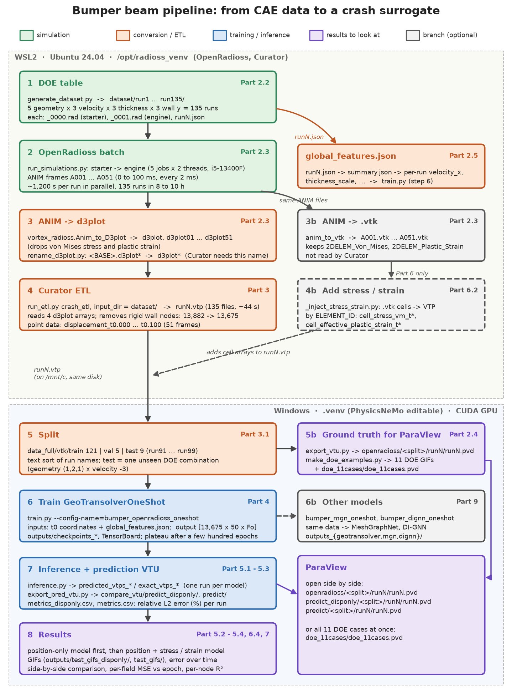

# NVIDIA PhysicsNeMo Part 6 — Bumper Beam Crash Surrogate (GeoTransolver)

A neural surrogate that predicts a full 100 ms bumper beam crash (every node, 50 time steps) in one forward pass, trained on 135 OpenRadioss simulations. Only open-source tools: **OpenRadioss** instead of LS-DYNA, **PhysicsNeMo-Curator** for the ETL, and **GeoTransolver** from NVIDIA PhysicsNeMo.



## Start here

| File | What it is |
|---|---|
| [`demo/bumper_beam_pipeline_tutorial.ipynb`](demo/bumper_beam_pipeline_tutorial.ipynb) | The whole pipeline, cell by cell, with the real outputs saved (English) |
| [`BUMPER_BEAM_REPRODUCTION.md`](BUMPER_BEAM_REPRODUCTION.md) | Step-by-step reproduction guide with every pitfall (Traditional Chinese) |
| [`notes/bumper_beam_geotransolver_notes.md`](notes/bumper_beam_geotransolver_notes.md) | Notes on the GeoTransolver architecture (Traditional Chinese) |

## Results (9 test runs)

| Model | Displacement relative L2 error | Displacement R² |
|---|---|---|
| GeoTransolver, position only | 13.6 % | 0.979 |
| GeoTransolver, position + stress + plastic strain | 42.9 % | 0.608 |

Adding the stress and strain targets makes the model overfit (train error 3.7 %, test 42.9 %); the likely cause is one MSE loss over channels with different scales (Part 6 of the notebook). Part 9 compares GeoTransolver with MeshGraphNet and a re-implementation of DI-GNN on the same data. All test runs are one parameter combination that never appears in training, so the test is an extrapolation.

## Folder layout

```
dataset_generation/   DOE generator, batch OpenRadioss runner, starter / engine decks, global_features.json
conf/                 Hydra experiment configs (bumper_openradioss_oneshot.yaml is the main one)
train.py, inference.py, datapipe.py, rollout.py, vtp_reader.py, zarr_reader.py, utils.py
post_processing/      VTU export, GIFs, error metrics, R² plots, model comparison
figures/              figures and GIFs used by the notebook and the guide
demo/                 the tutorial notebook
notes/                architecture notes
```

## Not included

The data and trained models are too large for git and are not in this folder:

- `dataset_generation/dataset/`: the 135 raw OpenRadioss runs (about 26 GB). Regenerate them with `generate_dataset.py` and `run_simulations.py` (8 to 10 hours on a 10-core CPU).
- `data_full/`: the Curator VTP files and the VTU exports for ParaView.
- `outputs*/`: checkpoints, TensorBoard logs, prediction files.

The notebook keeps all its outputs, so it can be read without running anything.

## How to run

The code expects to sit inside a local PhysicsNeMo checkout as `physicsnemo/examples/structural_mechanics/bumper_beam/`, with PhysicsNeMo installed in editable mode (`pip install -e . --no-deps`); see Part 1 of the guide. OpenRadioss and PhysicsNeMo-Curator (tag `PNM-25.11-Compatible`) run in WSL2, training runs in Windows Python with CUDA (tested on an 8 GB RTX 4060 Ti).

## Credits and licenses

- The training, datapipe and model code is adapted from the crash example of [NVIDIA PhysicsNeMo](https://github.com/NVIDIA/physicsnemo) (Apache License 2.0; the license headers are kept in the files).
- The bumper beam model (`Bumper_Beam_AP_meshed_*.rad`) is the official OpenRadioss example, © Altair Engineering Inc., licensed under [CC BY-NC 4.0](https://creativecommons.org/licenses/by-nc/4.0/).
